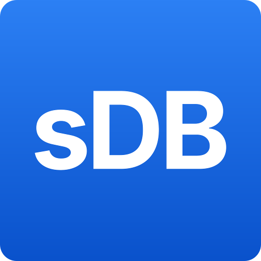

# safe-db: Safe database access for people and agents

  

  
  
  

  <a href="https://safe-db.dev/docs">Docs</a> |
  <a href="https://safe-db.dev/desktop">Desktop</a> |
  <a href="https://safe-db.dev/mcp">MCP</a> |
  <a href="https://safe-db.dev/downloads">Downloads</a> |
  <a href="https://safe-db.dev">Website</a>

Read-only access to production databases, for people and for agents. The 1.1.2 desktop app and the MCP server share one query engine: it introspects PostgreSQL, MySQL, SQL Server, Oracle, and Db2, compiles a structured `QuerySpec` to bound-parameter SQL, and runs a time-boxed, row-capped `SELECT`.

Packaged releases and the user guide are at [safe-db.dev](https://safe-db.dev). This repository is for building from source and changing the code.

The desktop app runs on macOS and Windows; [`Main.kt`](src/main/kotlin/com/safedb/Main.kt) rejects other operating systems before Compose, JDBC, or app data initialize. The MCP server also runs on Linux and is packaged as `@safe-db/mcp` (`npx -y @safe-db/mcp`). Connections, tools, and result receipts: [docs/mcp.md](docs/mcp.md).

## Layout

| Path | Role |
| --- | --- |
| Root (`src/`) | Compose Desktop UI, viewmodels, HTML/CSV/PNG export. Main class `com.safedb.MainKt`. |
| [`:shared`](shared/) | Query engine, JDBC adapters, SQL parser, stores, secrets, launch profiles. Not a published library. |
| [`:mcp`](mcp/) | Stdio MCP server CLI (`safe-db-mcp`), published as `@safe-db/mcp` with a bundled Temurin 25 jlink runtime. `setup` / `connections add` to save connections; tools for schema discovery, query assessment, execution, paging, in-memory analysis, and saved workspaces. See [docs/mcp.md](docs/mcp.md). |

## Contracts

Read [docs/query-engine.md](docs/query-engine.md) before changing the parser, validator, compiler, risk gate, or an adapter. The short version:

- Builder, SQL screen, and MCP `run_query` all produce a `QuerySpec`. Compilation binds parameters; typed SQL never reaches the database ([`SqlToSpec.kt`](shared/src/main/kotlin/com/safedb/query/sql/SqlToSpec.kt), [`Compile.kt`](shared/src/main/kotlin/com/safedb/query/Compile.kt)).
- Hikari pools are size 1 and `isReadOnly = true` ([`JdbcHelpers.kt`](shared/src/main/kotlin/com/safedb/adapter/JdbcHelpers.kt)). Connect timeout is ~10s (driver connect/login/socket properties plus an interruptible deadline).
- Row and `IN`-list caps live in [`Validate.kt`](shared/src/main/kotlin/com/safedb/query/Validate.kt) and [`QueryCore.kt`](shared/src/main/kotlin/com/safedb/query/QueryCore.kt). The query timeout is the stored setting, 1–120 seconds with a 10-second default. Risk-gate severity decides allow vs block; see [docs/query-engine.md](docs/query-engine.md).

## Working in this repo

| Command | Use |
| --- | --- |
| `./gradlew run` | Start the desktop app. |
| `./gradlew check` | PR gate: unit tests, discovery, Docker harness orchestration, Kover ratchets. |

Integration tests, Docker fixtures, and headless renders: [docs/testing.md](docs/testing.md). MCP server: [docs/mcp.md](docs/mcp.md). Managed PKCS12 launch profiles: [docs/trust-stores.md](docs/trust-stores.md). Windows and macOS packages are built with Conveyor: [docs/packaging.md](docs/packaging.md).

For local development or CI, `SAFEDB_KEYCHAIN_BACKEND=disabled` keeps connection credentials in memory instead of the OS store. Trust-store password lookup still uses the strict platform backend and never falls back to that in-memory store.

## Contributing

See [CONTRIBUTING.md](CONTRIBUTING.md). Run `./gradlew check` before opening a pull request. Release notes: [CHANGELOG.md](CHANGELOG.md).

## License

[Apache License 2.0](LICENSE.txt)
