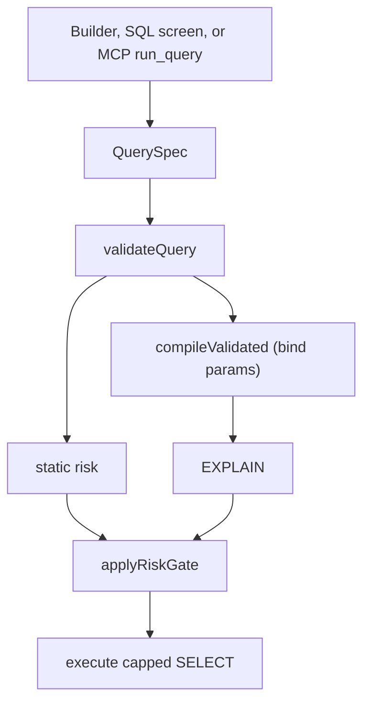

# Query engine

This is the contract for [`runQueryCore`](../shared/src/main/kotlin/com/safedb/query/QueryCore.kt) and dry-run [`assessQueryCore`](../shared/src/main/kotlin/com/safedb/query/QueryCore.kt). Read it before changing the parser, validator, compiler, risk gate, or a JDBC adapter. The desktop UI and the MCP `run_query` tool both go through this pipeline. MCP receipts, paging, and credentials are in [mcp.md](mcp.md). User-facing product docs live at [https://safe-db.dev/docs](https://safe-db.dev/docs).

## Pipeline

Builder, SQL screen, and MCP `run_query` all produce a [`QuerySpec`](../shared/src/main/kotlin/com/safedb/model/Ir.kt). Typed SQL is parsed in [`SqlToSpec.kt`](../shared/src/main/kotlin/com/safedb/query/sql/SqlToSpec.kt); the original text is not sent to the database.

[`compileValidated`](../shared/src/main/kotlin/com/safedb/query/Compile.kt) emits dialect SQL with bind parameters. Below the maximum 32-bit row cap, the compiled fetch size is `limit + 1` so the UI can tell a hit cap from an exact row count. That maximum is compiled as itself. An uncapped query emits no row-limit clause.

## Accepted SQL

`SELECT` only. Columns are real schema columns (or `table.*` / `SELECT *`), not expressions. `SELECT *` expands to the table's columns and does not warn "No columns selected". Compiled result columns are named `table__column`.

- `INNER JOIN` on column equality only (`a.x = b.y`). Each join column must be the leading key of an equality-capable index, or the join must be a complete foreign key ([`Validate.kt`](../shared/src/main/kotlin/com/safedb/query/Validate.kt)).
- Filters, including nested groups, up to `MAX_FILTER_DEPTH`.
- Optional `DISTINCT`, `GROUP BY` of columns, `ORDER BY`, and `LIMIT` (SQL Server `TOP`; Oracle and Db2 `FETCH FIRST`).

## Rejected SQL

User-facing reasons live in [`SqlMessages.kt`](../shared/src/main/kotlin/com/safedb/query/sql/SqlMessages.kt). The parser rejects:

- Writes and anything that is not `SELECT`
- Multiple statements
- CTEs (`WITH`)
- Subqueries
- Outer joins
- `UNION` / `INTERSECT` / `EXCEPT`
- `HAVING`
- `OFFSET`
- Column aliases
- Functions and SQL-level aggregates (`COUNT`, `SUM`, …)
- Expressions and calculations in the select list
- Optimizer hints (`/*+ … */`)
- MySQL executable comments (`/*! … */`); other dialects reject them as MySQL-style executable comments rather than treating them as ordinary comments
- National string literals (`N'…'`)
- Comparing two columns in a predicate

The validator then rejects tables in system/catalog schemas and in `blocked_schemas` from settings (`Schema 'x' is blocked`). This applies to the desktop risk preview and execution and to MCP `run_query`, `run_saved_query`, and `assess_query`. `save_query` rejects the same SQL before saving.

Aggregates belong in Explore, on the sample already fetched.

## Limits

Numbers are the constants, not copy. Change the constant and update this page in the same change.

| Constant | Value | File |
| --- | --- | --- |
| `DEFAULT_LIMIT` | 500 rows | [`Validate.kt`](../shared/src/main/kotlin/com/safedb/query/Validate.kt) |
| `LARGE_LIMIT_WARNING_THRESHOLD` | 1,000 rows | [`Validate.kt`](../shared/src/main/kotlin/com/safedb/query/Validate.kt) |
| `MAX_RESULT_BYTES` | 10 MiB encoded | [`Ir.kt`](../shared/src/main/kotlin/com/safedb/model/Ir.kt) |
| `MAX_IN_LIST_SIZE` | 1,000 values | [`Validate.kt`](../shared/src/main/kotlin/com/safedb/query/Validate.kt) |
| `MAX_FILTER_DEPTH` | 5 | [`Validate.kt`](../shared/src/main/kotlin/com/safedb/query/Validate.kt) |
| `DEFAULT_QUERY_TIMEOUT_SECONDS` | 10s default query timeout (1–120 via `MIN_QUERY_TIMEOUT_SECONDS` / `MAX_QUERY_TIMEOUT_SECONDS`) | [`Settings.kt`](../shared/src/main/kotlin/com/safedb/model/Settings.kt) |
| `DEFAULT_TIMEOUT_MS` | 10s adapter fallback for explain when no timeout is passed | [`JdbcHelpers.kt`](../shared/src/main/kotlin/com/safedb/adapter/JdbcHelpers.kt) |
| `CONNECT_TIMEOUT_MS` | 10s connect timeout (driver connect/login/socket properties plus an interruptible deadline) | [`JdbcHelpers.kt`](../shared/src/main/kotlin/com/safedb/adapter/JdbcHelpers.kt) |

A positive SQL limit is kept as given, up to the maximum value of a 32-bit integer. A larger whole number clamps to that maximum and remains a numeric cap. A capped spec limit of `0` becomes `DEFAULT_LIMIT`. An uncapped spec leaves the stored number as-is, including `0`; that number is ignored at compile time. Typed `LIMIT 0` is rejected. Omitting `LIMIT`, `TOP`, or `FETCH FIRST` is the same as the builder's ALL choice: `uncapped` is true, the stored numeric limit stays `DEFAULT_LIMIT`, and compiled SQL has no row-limit clause. The client reads with a statement fetch size (MySQL streams one row at a time; the other dialects use fetch size 128) and stops at `MAX_RESULT_BYTES`, then marks the sample truncated. The query timeout still applies. Large-limit guidance fires when the spec is uncapped or the numeric cap is above `LARGE_LIMIT_WARNING_THRESHOLD`.

`Settings.DEFAULT_QUERY_TIMEOUT_SECONDS` is the 10-second default. User query execution and the plan check before it use the stored query-timeout setting instead: whole seconds from `MIN_QUERY_TIMEOUT_SECONDS` to `MAX_QUERY_TIMEOUT_SECONDS` (1 to 120). `DEFAULT_TIMEOUT_MS` in [`JdbcHelpers.kt`](../shared/src/main/kotlin/com/safedb/adapter/JdbcHelpers.kt) is only the adapter fallback when a caller does not pass a timeout. Connect and schema introspection keep their fixed limits and do not follow the setting. A SQL Server query that hits the query timeout is reported as `Query timed out after …ms`, not `Connection is closed`.

Hikari `maximumPoolSize` is 1 and `isReadOnly` is true ([`JdbcHelpers.kt`](../shared/src/main/kotlin/com/safedb/adapter/JdbcHelpers.kt)).

## Risk gate

Settings are `Cautious`, `Standard`, `Flexible`, and `Disabled` ([`Settings.kt`](../shared/src/main/kotlin/com/safedb/model/Settings.kt)). [`applyRiskGate`](../shared/src/main/kotlin/com/safedb/query/QueryRiskGate.kt) blocks from `Elevated` for `Cautious`, `High` for `Standard`, and `VeryHigh` for `Flexible`; `Disabled` has no blocking threshold. Severity alone decides: a plan-confirmed large scan is not an extra hard block beyond that band.

Postgres `EXPLAIN` row estimates account for a `Limit` node that can stop early (a nested loop or a direct scan). A `LIMIT 1` seq scan is therefore Low-band, not a million-row scan. Hash/merge joins, sorts, and aggregates still report uncapped input rows because `LIMIT` does not bound that work. MySQL `EXPLAIN FORMAT=JSON` often leaves `rows` / `rows_examined_per_scan` at the table cardinality; when the access path can stop early (a plain scan or a ref/eq_ref lookup with no filesort, temporary table, or grouping), those estimates are capped by a JSON Limit or the query's `LIMIT`. Join risk uses the larger of join output rows and either side's examined rows, including a nested-loop / `ref` / `eq_ref` inner. A large estimated row set on either side is also plan-confirmed large-scan evidence, so an indexed FK nested loop is High regardless of drive order. When a Limit node (or MySQL `LIMIT` cap) keeps examined and output rows in the Low band, static FK-without-index and join-expansion signals are ignored so a LIMITed join stays Minimal.

[`runQueryCore`](../shared/src/main/kotlin/com/safedb/query/QueryCore.kt) returns [`QueryError.RiskGate`](../shared/src/main/kotlin/com/safedb/query/QueryCore.kt) first when `baseEvaluation.decision` violates the configured risk gate (or remains `AssessmentPending`), including a missing plan or invalid optimizer cost that still fails that gate. A plan-check timeout or connection/I/O failure is [`QueryError.Execution`](../shared/src/main/kotlin/com/safedb/query/QueryCore.kt) with a short message, not a confirm prompt. Only when no earlier risk-gate or transport failure applies does a missing plan or a missing/invalid optimizer cost return [`QueryError.ConfirmationRequired`](../shared/src/main/kotlin/com/safedb/query/QueryCore.kt) rather than running. A high but finite cost does not. `Disabled` turns off descriptive scoring and skips `EXPLAIN`, so a plan-check failure cannot block or prompt. SQL Server plans for bound parameters are `DECLARE` batches; optimizer cost is read from the `SELECT` statement, not the leading assignment, so a valid `SELECT` cost is not treated as missing.

## Adapters

| Dialect | Session | Trust |
| --- | --- | --- |
| PostgreSQL | `SET TRANSACTION READ ONLY, ISOLATION LEVEL READ UNCOMMITTED` | Verified TLS keeps pgjdbc trust and client certificates unless a launch profile is set. |
| MySQL | `SET TRANSACTION READ ONLY, ISOLATION LEVEL READ UNCOMMITTED` | JVM trust, or a launch-profile PKCS12 store. |
| SQL Server | JDBC `autoCommit = false`, isolation `READ_UNCOMMITTED`, `SET LOCK_TIMEOUT` (restored to `-1` in `finally`); no `BEGIN TRANSACTION` or `SET TRANSACTION READ ONLY` | JVM trust, or a launch-profile PKCS12 store. |
| Oracle | `SET TRANSACTION READ ONLY` | Verified TCPS uses an Oracle wallet. A generic PKCS12 launch profile is not a substitute. |
| Db2 | No session SQL. JDBC `autoCommit = false`, `isReadOnly = true`, and isolation `READ UNCOMMITTED` | JVM trust, no wallet. `sslConnection` is a connection property, not part of the connect URL. |

Oracle and Db2 `EXPLAIN` (`EXPLAIN PLAN`) insert rows into database plan tables (`plan_table` on Oracle; `EXPLAIN_INSTANCE` / `EXPLAIN_*` on Db2 LUW or `PLAN_TABLE` on Db2 z/OS) and delete those rows afterward, discarding plan evidence (`CleanupFailure`) if cleanup fails. Setting the risk gate to `Disabled` skips `EXPLAIN` entirely and avoids those plan-table writes. SQL Server uses `SET SHOWPLAN_XML ON` (restored to `OFF` afterward) and does not write a plan table.

A pasted Db2 connection string is not the connect URL. [`formatConnectionString`](../shared/src/main/kotlin/com/safedb/connection/ParseConnectionString.kt) keeps `sslConnection=true` or `sslConnection=false` on that string so the transport mode round-trips. [`buildDb2Url`](../shared/src/main/kotlin/com/safedb/adapter/JdbcHelpers.kt) omits `sslConnection`. JCC 12 rejects `Driver.connect` when the property is in both the URL and the `Properties` object (`ERRORCODE=-4461`). [`applyDb2Ssl`](../shared/src/main/kotlin/com/safedb/adapter/JdbcHelpers.kt) sets it as a connection property after any pasted driver properties: `false` when transport is disabled, `true` otherwise, plus `sslClientHostnameValidation=BASIC` when SSL is on. Encrypt-only and verify-ca are not distinct from verify-identity on JCC.

A TLS handshake failure while connecting is reported as could-not-connect with a hint to check the transport setting, on the desktop app and MCP.

Launch-profile schema, fail-closed startup, and the SSL harness are in [trust-stores.md](trust-stores.md).

## Explore and export

Pivot, worksheet, and visualization mutate an immutable sample, not the `QuerySpec`. CSV, chart PNG, and the HTML report carry the rows already fetched: no connection, credentials, or live query. Recipes store layout only; they can be imported on another machine without secrets or result rows.

MCP `run_query` uses this same pipeline and returns a receipt with a short preview, not the full sample. Page or summarize with `get_result_rows` / `summarize_result`. See [mcp.md](mcp.md).
