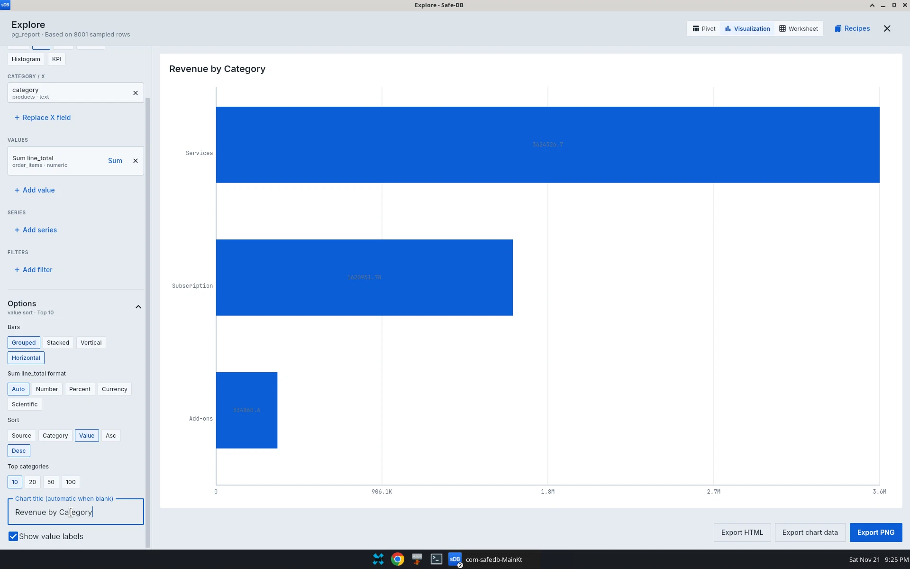
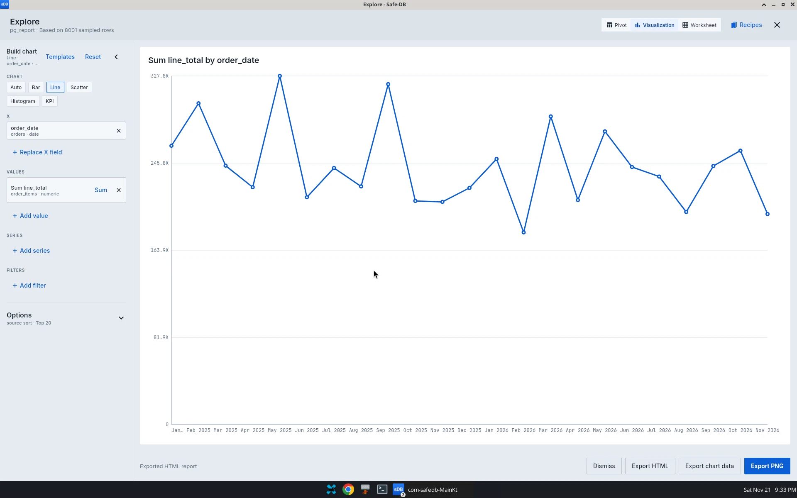
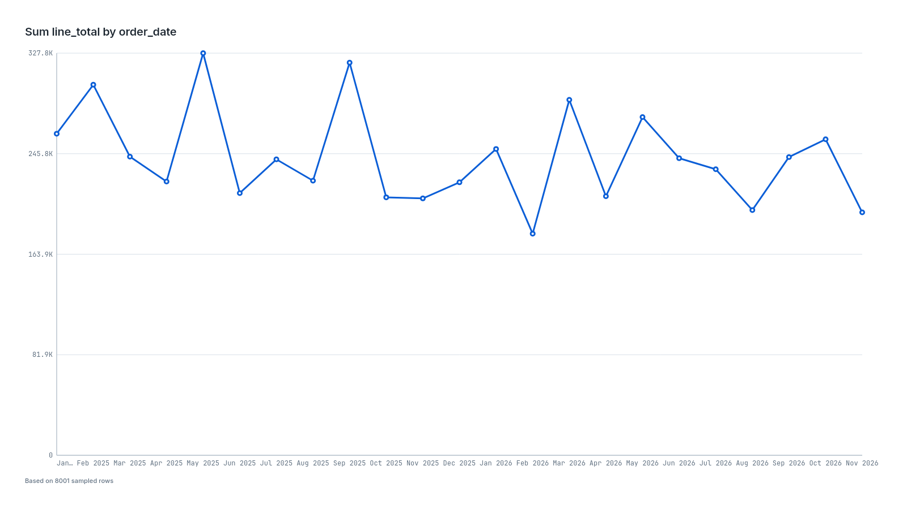

# Visualization and report-export test

21 November 2026 (America/Chicago)

Explore visualization plus PNG, HTML, and CSV export, tested on Linux against `main` `91aa845` (v1.1.3). Nothing in this report was fixed in the product. Candidate issues are listed as findings only.

## Test data

Postgres database `safedb_test` on `127.0.0.1:5432`, schema `sales`. The schema is in [`seed/schema.sql`](seed/schema.sql). Row data was randomly generated and is not checked in.

| Table | Rows | Notes |
| --- | ---: | --- |
| `sales.regions` | 4 | North America, Europe, Asia Pacific, Latin America |
| `sales.products` | 8 | Subscription (3), Services (2), Add-ons (3) |
| `sales.accounts` | 240 | Enterprise, Mid-Market, and SMB, 80 each |
| `sales.orders` | 4000 | Dated 2025-01-01 through 2026-11-21 |
| `sales.order_items` | 8001 | |

Connection used in the app: `pg_report`.

The first seed omitted Add-ons and produced incorrect category totals. Those round-1 exports are in [`exports/superseded/`](exports/superseded/). All results below are from the corrected seed.

## Report A: Revenue by Category

SQL:

```sql
SELECT p.category, oi.line_total
FROM sales.order_items oi
JOIN sales.products p ON oi.product_id = p.id
```

Explore settings: Top values template, horizontal bar, `Sum(line_total)` by `category`, title "Revenue by Category", value labels on, sort by value descending.

| Category | Explore / export value | SQL `sum(line_total)` |
| --- | ---: | ---: |
| Services | 3,624,326.7 | 3,624,326.70 |
| Subscription | 1,620,951.78 | 1,620,951.78 |
| Add-ons | 334,860.6 | 334,860.60 |

These match direct SQL aggregation. The HTML report was sampled at 21:22 and generated at 21:29 (America/Chicago) on 21 November 2026, based on all 8,001 rows (`sampleTruncated: false`).

- App: [screenshots/20-revenue-by-category.webp](screenshots/20-revenue-by-category.webp)
- Chart PNG: [exports/revenue-by-category-v2.png](exports/revenue-by-category-v2.png)
- HTML report: [exports/revenue-by-category-v2.html](exports/revenue-by-category-v2.html)
- HTML rendered in a browser: [screenshots/html-report-render.png](screenshots/html-report-render.png)




## Report B: Monthly revenue

SQL:

```sql
SELECT o.order_date, oi.line_total
FROM sales.order_items oi
JOIN sales.orders o ON oi.order_id = o.id
```

Explore settings: line chart, X = `order_date` grouped by month, `Sum(line_total)`, automatic title "Sum line_total by order_date". All 23 months from January 2025 through November 2026 were plotted. Options showed source sort and Top 20; the Top 20 cap did not drop any months.

The monthly totals in the HTML chart-data table match direct SQL aggregation. Peak month: May 2025 at 327,777.59. Low month: February 2026 at 180,647.23. The HTML report was sampled at 21:31 and generated at 21:33 (America/Chicago) on 21 November 2026.

No CSV was exported for this report.

- App: [screenshots/21-monthly-revenue.webp](screenshots/21-monthly-revenue.webp)
- Chart PNG: [exports/monthly-revenue.png](exports/monthly-revenue.png)
- HTML report: [exports/monthly-revenue.html](exports/monthly-revenue.html)





## Reports still pending

The following were queued and are not in this commit. They can be added in a follow-up.

### C: Revenue by region and segment

```sql
SELECT r.name AS region, a.segment, oi.line_total
FROM sales.order_items oi
JOIN sales.orders o ON oi.order_id = o.id
JOIN sales.accounts a ON o.account_id = a.id
JOIN sales.regions r ON a.region_id = r.id
```

### D: Two values on one chart

Still to be built in Explore (for example average order value alongside sum of `line_total`, or two measures on a shared category axis).

### E: Drill-down source-rows export

Open a mark's source rows and use Export rows. Not yet captured.

## Findings

These are candidate app issues from this pass. They were not fixed.

- Bar value labels are dark gray on dark blue, and are nearly unreadable in both the app and the PNG. See [screenshots/20-revenue-by-category.webp](screenshots/20-revenue-by-category.webp) and [exports/revenue-by-category-v2.png](exports/revenue-by-category-v2.png).
- Value labels show raw unformatted numbers (`3624326.7`) while the axis uses K/M compact formatting.
- Axis ticks land on odd steps. Report A uses 906.1K, 1.8M, 2.7M, 3.6M. Report B uses 81.9K, 163.9K, 245.8K, 327.8K.
- The HTML report omits value labels even when they are enabled in Explore. Compare the PNG with [screenshots/html-report-render.png](screenshots/html-report-render.png).
- The HTML chart-data table repeats `Sum line_total` in both the Series and Measure columns, and its values are unformatted (`3624326.7`).
- Explore kept showing a stale "8000 sampled rows" caption after the SQL was re-run on the corrected 8,001-row seed.
- Choosing Histogram silently clears the X and value assignments, leaving only an orange note.
- Templates were initially unresponsive.
- The Export dialog defaults to the app's working directory.
- Connection cards do not connect directly; you have to use SQL > Choose connection.
- Small hit targets.
- The Explore window can hide behind the main window.
- The CSV export holds aggregated chart data only, not source rows.
- The HTML report needs JavaScript to render the chart.
- The taskbar title shows `com-safedb-MainKt`. This is likely Linux-only.

## Harness-only notes

These came from the test setup and are not app bugs, but they are worth knowing.

- The password is lost on restart because the keychain backend was disabled for the Linux test harness (`SAFEDB_KEYCHAIN_BACKEND=disabled`). The password is held only in memory.
- Force-closing the Explore window kills the whole app, because Explore shares a JVM with the main window.
