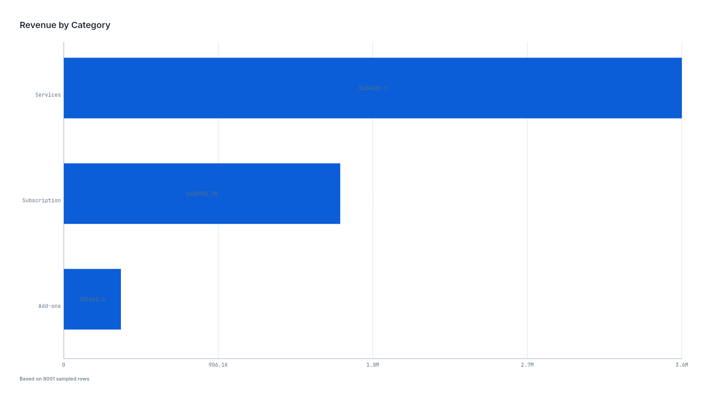
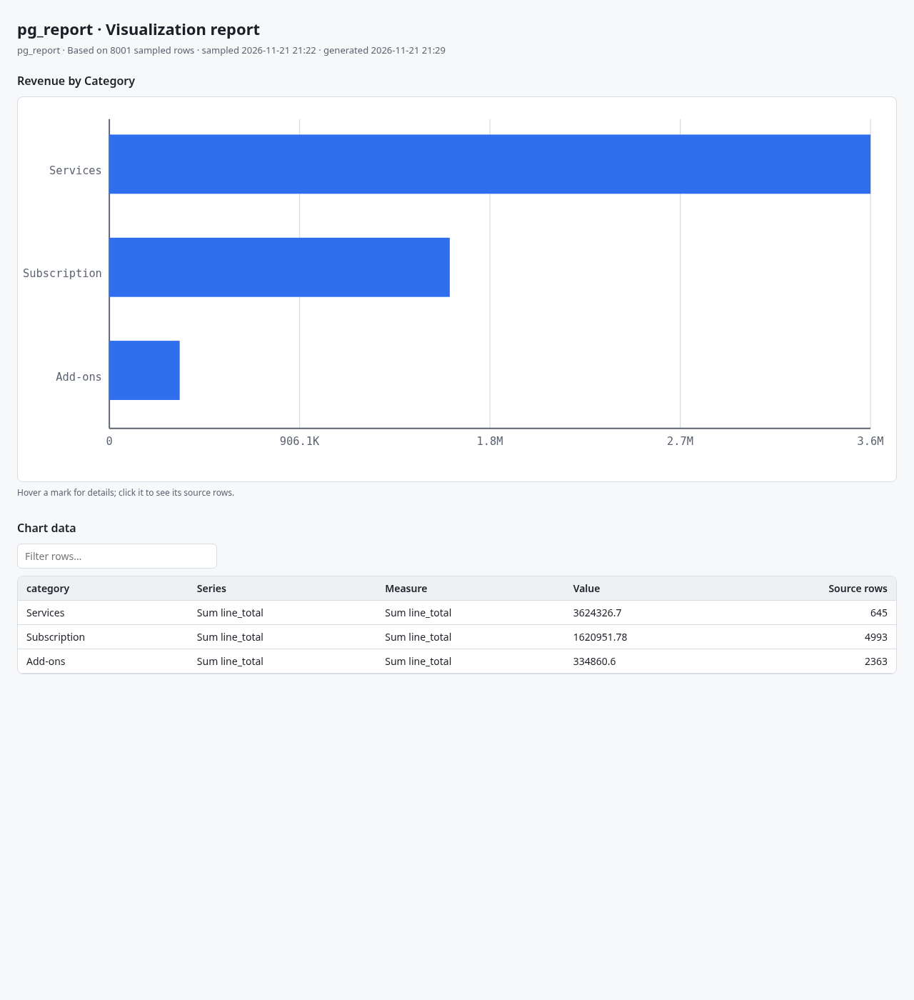
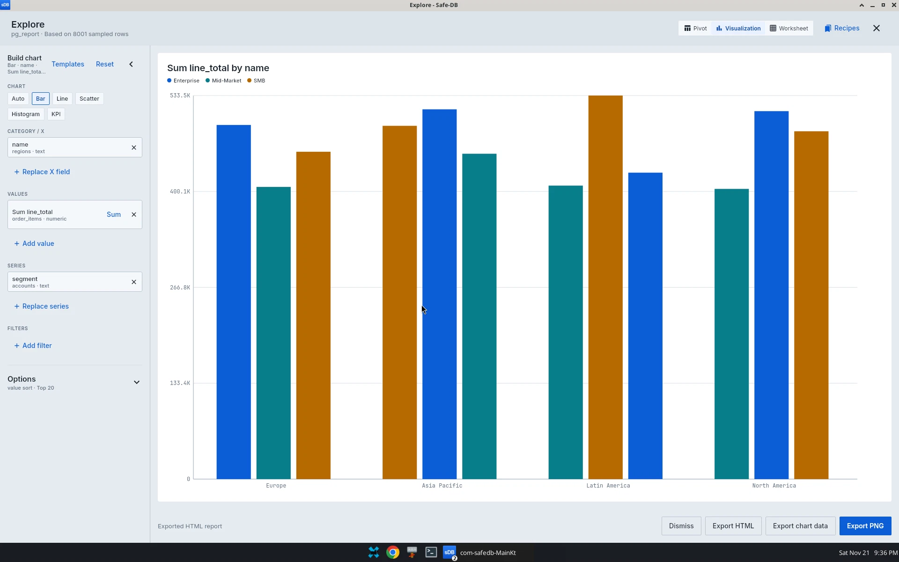
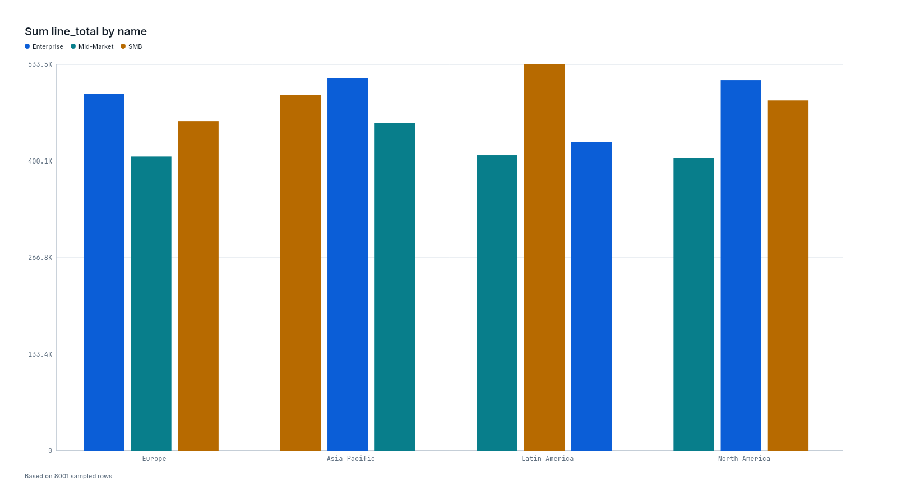

# Visualization and report-export test

21 November 2026 (America/Chicago)

Explore visualization plus PNG, HTML, and CSV export, tested on Linux against `main` `91aa845` (v1.1.3). Nothing in this report was fixed in the product. Candidate issues are listed as findings only.

## Test data

Postgres database `safedb_test` on `127.0.0.1:5432`, schema `sales`. The schema is in [`seed/schema.sql`](seed/schema.sql). Row data was randomly generated and is not checked in.

| Table | Rows | Notes |
| --- | ---: | --- |
| `sales.regions` | 4 | North America, Europe, Asia Pacific, Latin America |
| `sales.products` | 8 | Subscription (3), Services (2), Add-ons (3) |
| `sales.accounts` | 240 | Enterprise, Mid-Market, and SMB, 80 each |
| `sales.orders` | 4000 | Dated 2025-01-01 through 2026-11-21 |
| `sales.order_items` | 8001 | |

Connection used in the app: `pg_report`.

The first seed omitted Add-ons and produced incorrect category totals. Those round-1 exports are in [`exports/superseded/`](exports/superseded/). All results below are from the corrected seed.

## Report A: Revenue by Category

SQL:

```sql
SELECT p.category, oi.line_total
FROM sales.order_items oi
JOIN sales.products p ON oi.product_id = p.id
```

Explore settings: Top values template, horizontal bar, `Sum(line_total)` by `category`, title "Revenue by Category", value labels on, sort by value descending.

| Category | Explore / export value | SQL `sum(line_total)` |
| --- | ---: | ---: |
| Services | 3,624,326.7 | 3,624,326.70 |
| Subscription | 1,620,951.78 | 1,620,951.78 |
| Add-ons | 334,860.6 | 334,860.60 |

These match direct SQL aggregation. The HTML report was sampled at 21:22 and generated at 21:29 (America/Chicago) on 21 November 2026, based on all 8,001 rows (`sampleTruncated: false`).

- App: [screenshots/20-revenue-by-category.webp](screenshots/20-revenue-by-category.webp)
- Chart PNG: [exports/revenue-by-category-v2.png](exports/revenue-by-category-v2.png)
- HTML report: [exports/revenue-by-category-v2.html](exports/revenue-by-category-v2.html)
- HTML rendered in a browser: [screenshots/html-report-render.png](screenshots/html-report-render.png)






## Report B: Monthly revenue

SQL:

```sql
SELECT o.order_date, oi.line_total
FROM sales.order_items oi
JOIN sales.orders o ON oi.order_id = o.id
```

Explore settings: line chart, X = `order_date` grouped by month, `Sum(line_total)`, automatic title "Sum line_total by order_date". All 23 months from January 2025 through November 2026 were plotted. Options showed source sort and Top 20; the Top 20 cap did not drop any months.

The monthly totals in the HTML chart-data table match direct SQL aggregation. Peak month: May 2025 at 327,777.59. Low month: February 2026 at 180,647.23. The HTML report was sampled at 21:31 and generated at 21:33 (America/Chicago) on 21 November 2026.

No CSV was exported for this report.

- App: [screenshots/21-monthly-revenue.webp](screenshots/21-monthly-revenue.webp)
- Chart PNG: [exports/monthly-revenue.png](exports/monthly-revenue.png)
- HTML report: [exports/monthly-revenue.html](exports/monthly-revenue.html)


## Report C: Revenue by region and segment

The planned SQL used `r.name AS region`, but the app's editor gate says "Column aliases aren't supported" and leaves Run disabled. The query that actually ran:

```sql
SELECT r.name, a.segment, oi.line_total
FROM sales.order_items oi
JOIN sales.orders o ON oi.order_id = o.id
JOIN sales.accounts a ON o.account_id = a.id
JOIN sales.regions r ON a.region_id = r.id
```

Explore settings: Compare categories template, X = `name` (regions), series = `segment`, `Sum(line_total)`, grouped vertical bars, automatic title "Sum line_total by name". Because aliases are blocked, the region column appears only as `name` in Explore and in the HTML chart-data table.

All 12 region/segment totals in the HTML table match direct SQL aggregation. The HTML report was sampled at 21:34 and generated at 21:36 (America/Chicago) on 21 November 2026, based on all 8,001 rows.

| Region | Segment | Explore / export value | SQL `sum(line_total)` | Source rows |
| --- | --- | ---: | ---: | ---: |
| Asia Pacific | Enterprise | 514,374.14 | 514,374.14 | 665 |
| Asia Pacific | Mid-Market | 452,581.03 | 452,581.03 | 630 |
| Asia Pacific | SMB | 491,419.68 | 491,419.68 | 693 |
| Europe | Enterprise | 492,622.41 | 492,622.41 | 738 |
| Europe | Mid-Market | 406,430.58 | 406,430.58 | 654 |
| Europe | SMB | 455,337.98 | 455,337.98 | 652 |
| Latin America | Enterprise | 426,263.9 | 426,263.90 | 640 |
| Latin America | Mid-Market | 408,247.63 | 408,247.63 | 601 |
| Latin America | SMB | 533,532.96 | 533,532.96 | 679 |
| North America | Enterprise | 511,826.37 | 511,826.37 | 715 |
| North America | Mid-Market | 403,670.9 | 403,670.90 | 598 |
| North America | SMB | 483,831.5 | 483,831.50 | 736 |

Highest group: Latin America SMB at 533,532.96. Lowest: North America Mid-Market at 403,670.90. Axis ticks are 133.4K, 266.8K, 400.1K, and 533.5K.

- App: [screenshots/22-revenue-by-region-segment.webp](screenshots/22-revenue-by-region-segment.webp)
- Chart PNG: [exports/revenue-by-region-segment.png](exports/revenue-by-region-segment.png)
- HTML report: [exports/revenue-by-region-segment.html](exports/revenue-by-region-segment.html)





## Report E: Drill-down source-rows export

Clicking the Europe / SMB bar opened Source rows (652 rows). Export rows produced [exports/drill-rows.csv](exports/drill-rows.csv).

The CSV header is `r__name,a__segment,oi__line_total`. All 652 rows are Europe / SMB. The row count and the sum of `oi__line_total` (455,337.98) match direct SQL for that group.

## Reports not completed

### D: Two values on one chart (blocked)

In the app, "+ Add value" kept opening "Replace X field" instead of adding a second measure, so no two-value chart could be built. See findings.

### F: Histogram

Not attempted.

## Findings

These are candidate app issues from this pass. They were not fixed.

- Bar value labels are dark gray on dark blue, and are nearly unreadable in both the app and the PNG. See [screenshots/20-revenue-by-category.webp](screenshots/20-revenue-by-category.webp) and [exports/revenue-by-category-v2.png](exports/revenue-by-category-v2.png).
- Value labels show raw unformatted numbers (`3624326.7`) while the axis uses K/M compact formatting.
- Axis ticks land on odd steps. Report A uses 906.1K, 1.8M, 2.7M, 3.6M. Report B uses 81.9K, 163.9K, 245.8K, 327.8K. Report C uses 133.4K, 266.8K, 400.1K, 533.5K.
- The HTML report omits value labels even when they are enabled in Explore. Compare the PNG with [screenshots/html-report-render.png](screenshots/html-report-render.png).
- The HTML chart-data table repeats `Sum line_total` in both the Series and Measure columns, and its values are unformatted (`3624326.7`).
- Explore kept showing a stale "8000 sampled rows" caption after the SQL was re-run on the corrected 8,001-row seed.
- Choosing Histogram silently clears the X and value assignments, leaving only an orange note.
- Templates were initially unresponsive.
- The Export dialog defaults to the app's working directory.
- Connection cards do not connect directly; you have to use SQL > Choose connection.
- Small hit targets.
- The Explore window can hide behind the main window.
- The Export chart data CSV holds aggregated chart data only. Source rows are available through Export rows on a drill-down, as in Report E.
- The HTML report needs JavaScript to render the chart.
- The taskbar title shows `com-safedb-MainKt`. This is likely Linux-only.
- Column aliases are blocked in SQL. This is a notable limitation, because columns such as `r.name` then show up only as `name` in Explore and `r__name` in the CSV, which makes them ambiguous.
- The drill-rows CSV headers use `alias__column` mangling (`r__name`, `a__segment`, `oi__line_total`).
- "+ Add value" opens "Replace X field" instead of adding a second measure. This blocked Report D.
- The save dialog defaulted to the home directory and suggested an odd filename (`start-safedb-111.sh.csv`), apparently derived from a file that was selected in the list.
- The file list in the save dialog easily steals focus from the File Name field.
- The Visual templates link and the sidebar suggestion cards are easy to mis-click.

## Harness-only notes

These came from the test setup and are not app bugs, but they are worth knowing.

- The password is lost on restart because the keychain backend was disabled for the Linux test harness (`SAFEDB_KEYCHAIN_BACKEND=disabled`). The password is held only in memory.
- Force-closing the Explore window kills the whole app, because Explore shares a JVM with the main window.
